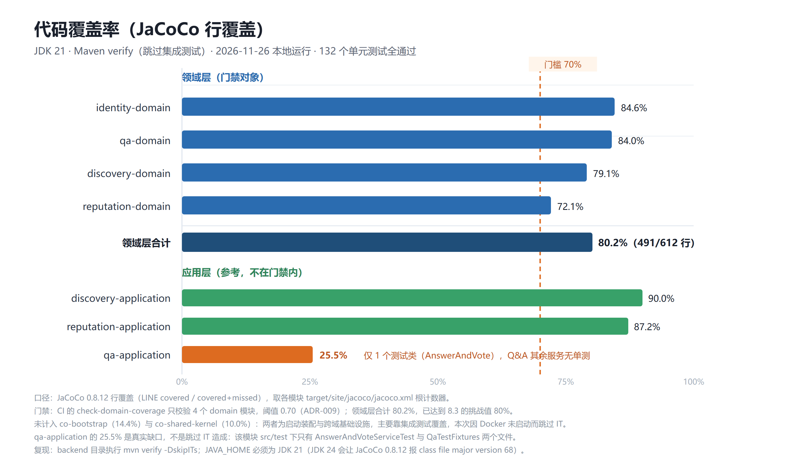
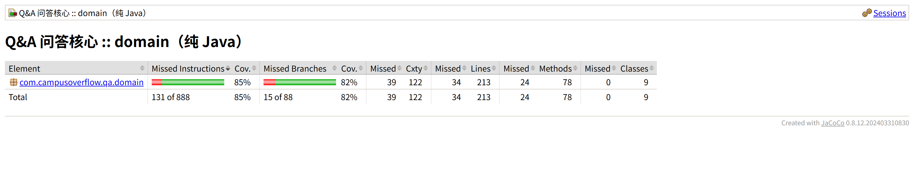

# 测试与覆盖率报告

本目录存放 Sprint 4 验收所需的测试结果与覆盖率证据（实验指导书 9.4 第 6 项）。

## 1. 本次运行

| 项 | 值 |
|---|---|
| 命令 | `mvn verify -DskipITs`（在 `backend/` 目录） |
| JDK | 21（`JAVA_HOME=D:\jdk21`） |
| Maven | 3.9.14，离线模式 `-o` |
| 时间 | 2026-11-26 10:12（本地） |
| 结果 | `BUILD SUCCESS`，132 个单元测试全部通过，0 failure / 0 error |
| JaCoCo | 0.8.12，`check-domain-coverage` 四个领域模块全部 `All coverage checks have been met` |

**为什么跳过集成测试**：本机 Docker 服务未启动，Testcontainers 无法拉起 MySQL/Redis。集成测试（`CampusOverflowFlowIT`、`DemoDataSeederIT`）在 CI 上正常执行，本次本地运行只验证单元测试与领域层覆盖率门禁。

## 2. 覆盖率结果（行覆盖）



| 模块 | 行覆盖 | 未覆盖/总行 | 分支覆盖 |
|---|---|---|---|
| co-identity-domain | 84.6% | 22 / 143 | 67.1% |
| co-qa-domain | 84.0% | 34 / 213 | 83.0% |
| co-discovery-domain | 79.1% | 19 / 91 | 66.1% |
| co-reputation-domain | 72.1% | 46 / 165 | 73.8% |
| **领域层合计** | **80.2%** | 121 / 612 | — |
| co-discovery-application | 90.0% | 16 / 160 | 75.9% |
| co-reputation-application | 87.2% | 28 / 218 | 71.7% |
| co-qa-application | 25.5% | 205 / 275 | 16.7% |
| co-discovery-interfaces | 54.4% | 36 / 79 | 56.2% |
| co-bootstrap | 14.4% | 256 / 299 | 14.1% |
| co-shared-kernel | 10.0% | 54 / 60 | 15.6% |

原始 JaCoCo 报告页（`co-qa-domain`）：



## 3. 结论

**达标项**

- 四个领域模块全部通过 0.70 门禁（ADR-009），最低的 reputation 为 72.1%，其余均在 79% 以上。
- 领域层加权合计 **80.2%（491/612 行）**，达到 8.3 中「挑战值 80%」。
- 每个领域模块都有独立测试类，且 132 个用例全绿，无跳过用例。

**缺口（如实记录，未做美化）**

1. **`co-qa-application` 只有 25.5%**。该模块 `src/test` 下只有 `AnswerAndVoteServiceTest` 与 `QaTestFixtures` 两个文件，`QuestionService`、`CommentService`、编辑/采纳/软删除等应用服务没有单元测试，它们的正确性实际依赖 `CampusOverflowFlowIT` 的端到端断言。这是本项目最明显的测试短板。
2. **`co-bootstrap` 14.4%、`co-shared-kernel` 10.0%** 偏低。两者分别是启动装配与跨域基础设施（`IntegrationEvent`、`EventIds`、发件箱接口），单元测试只覆盖了 `OutboxRelayGateTest`、`OutboxRelayPausedTest` 与少量内核类，其余靠集成测试。二者不在门禁范围，但会让「整体覆盖率」看起来很低，汇报时需说明口径。
3. **CI 目前只归档 Surefire XML，没有上传 JaCoCo HTML**。`.github/workflows/ci.yml` 的 `upload-artifact` 路径是 `**/target/*-reports/*.xml`，评审时无法直接看到覆盖率页面。建议追加 `**/target/site/jacoco/**`。

## 4. 复现步骤

```powershell
$env:JAVA_HOME = "D:\jdk21"          # 必须 JDK 21，JDK 24 会让 JaCoCo 0.8.12 报 major version 68
Set-Location backend
mvn -o -B verify -DskipITs
# 报告位置：各模块 target/site/jacoco/index.html
# 原始计数：各模块 target/site/jacoco/jacoco.xml（本报告数字取自其根 counter）
```

如需完整跑集成测试，先启动 Docker Desktop，再去掉 `-DskipITs`（会拉起 Testcontainers 的 MySQL 与 Redis）。

## 5. 数字的来源

本报告所有百分比均由 `jacoco.xml` 的根 `counter` 现算：`covered / (covered + missed)`，未使用 HTML 页面的四舍五入值。未覆盖行数直接取 `LINE.missed`。
