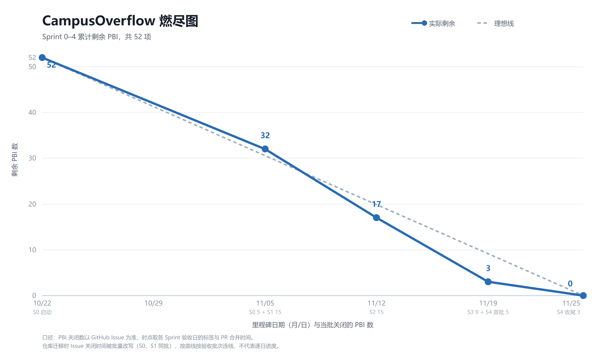

# 燃尽图（Sprint 0–4）

## 1. 数据

| 时点 | 当批关闭 | 累计完成 | 剩余 | 对应 Sprint |
|---|---|---|---|---|
| 2026-10-22 | — | 0 | 52 | S0 启动 |
| 2026-11-05 | 20 | 20 | 32 | S0（5）+ S1（15）验收 |
| 2026-11-12 | 15 | 35 | 17 | S2 验收 |
| 2026-11-19 | 14 | 49 | 3 | S3（9）+ S4 首批（5：#48/#49/#50/#52/#53） |
| 2026-11-25 | 3 | 52 | 0 | S4 收尾（#46/#47/#51），v1.0.1 |

PBI 总数 52，与 5 个里程碑的 Issue 数一致（S0 5、S1 15、S2 15、S3 9、S4 8）。

## 2. 口径与局限（必读）

- 关闭数以 GitHub Issue 的 `closed_at` 为准，时点取各 Sprint 验收当天（标签与 PR 合并日相同）。
- **仓库从个人仓库迁移到组织仓库时，S0 与 S1 的 20 个 Issue 被批量改写关闭时间（同为 2026-11-05 02:04–02:09），S2 为 11-12 08:25、S3 为 11-19 02:00–02:36，均在同一分钟内完成。** 因此本图只保留 4 个真实可核验的时点，按验收批次连线，**不代表逐日进度**，也不能当作"每天完成多少"的证据。
- 逐日进度可核验的替代证据是提交历史：`git log` 显示 2026-W43 至 W48 每周提交数为 23、15、4、12、40、7，共 101 次。
- 未做 5 张"Sprint 内日级燃尽图"，正是因为该粒度的数据已被迁移破坏；强行按 Issue 时间摊平到每天会与学生仓库的真实提交对不上，属于伪造，故不做。

## 3. 从图上能读出的三件事

1. **前 3 周基本贴着理想线**：11/05 时累计完成 20/52，与理想线偏差 2 个 PBI 以内，说明 S0/S1 的节奏是稳的。
2. **11/12 之后明显加速偏离**：S2 与 S3 的完成速度快于理想线，代价是 S2 末期出现"批量补完"（15 个 PBI 在同一天关闭），对应 Sprint 2 记录的回顾项——任务验收滞后于实现。
3. **最后一批只剩 3 个 PBI 却跨了 6 天**：11/19 之后剩余 3 项是 #46/#47/#51，实际拖到 11/25 才关闭，期间补的是 #98/#99 两个缺陷与本次文档交付，属于收尾阶段的返工，而非新功能。
